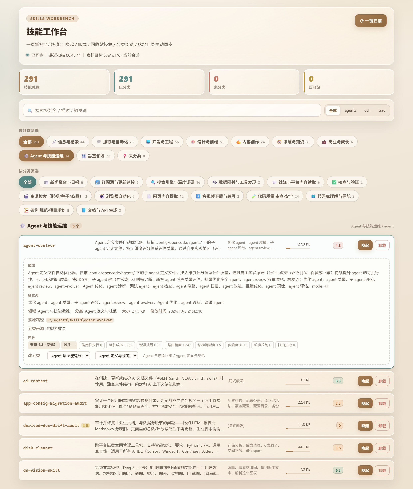
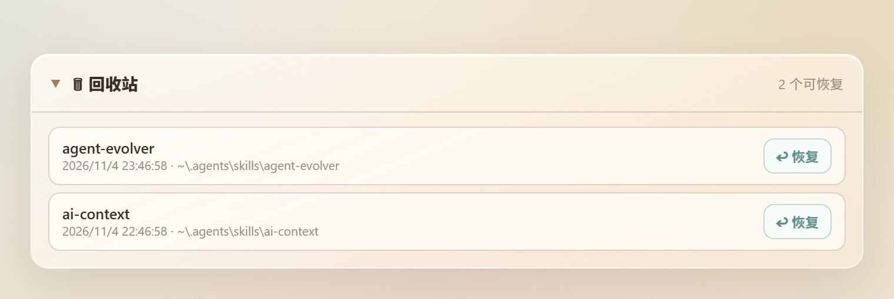

# 技能工作台 · Skills Workbench

把技能清单做成一页可控面板：**一键唤起**进当前会话输入框、**卸载到回收站**并可恢复、**按分类浏览**、对多个技能落地目录做**主动同步**。

---

## 界面预览



*主面板：技能总数/分类统计、搜索、领域与分类胶囊筛选、技能列表。图中第一行已展开详情卡——完整描述、触发词、落地路径、效率/风评与七维评分、行内改分类。*



*回收站：卸载的技能不删文件，可一键原位恢复。*

---

## 安装

1. 保持本目录完整（不要只拷单个文件），放到任意位置
2. 执行：

```bash
plugin_manager install_bundle target=<本目录绝对路径>
```

3. **重启桌面端**（插件的主机半边需要在启动时加载）
4. 侧边栏出现「技能工作台」图标，点开即可使用

> 也可以按 DSH 的常规做法，在 profile 的 `cordis.patch.yml` 中插入本包并加入依赖 —— 但推荐用 `install_bundle`，它会自动处理清单与依赖。

## 使用

| 操作 | 位置 | 说明 |
|---|---|---|
| 查看详情 | 点击任意技能行 | 展开完整信息：完整描述、触发词、领域/分类、大小、修改时间、落地路径（点击复制）、副本、分类来源与理由、效率/风评及七维明细；再点一次收起 |
| 唤起 | 每行右侧「唤起」 | 把 `/技能名 ` 写进当前会话输入框并切回会话；若无法确定目标会话会弹出选择器，点选一次即记住 |
| 卸载 | 每行右侧「卸载」 | 首次点击变「确认卸载」，4 秒内再点才执行；技能移入回收站可原位还原。唯一例外：技能目录与回收站不在同一磁盘分区时，会先复制到回收站再删除原目录（跨分区无法 rename）——文件内容仍完整保存在回收站里 |
| 恢复 | 面板底部「🗑 回收站」 | 列出已卸载技能，点「↩ 恢复」原位还原 |
| 分类筛选 | 顶部搜索框 / 领域·分类胶囊 | 支持行内改分类，选择会持久保存 |
| 同步 | 顶部「⟳ 一键扫描」 | 平时自动感知目录变化，此按钮是手动兜底 |

## 技能目录

插件会自动扫描以下目录（存在才扫，全部缺失也不报错）：

- `~/.agents/skills`（跨 harness 共享池，主要位置）
- `$DSH_HOME/skills` 或 `~/.dsh/skills`
- `~/.trae-cn/skills`

每个技能为 `<目录名>/SKILL.md`，其 frontmatter 的 `name` / `description` 会被读取用于展示与分类。

## 兼容性

| 项 | 要求 |
|---|---|
| DSH 内核 | `>= 0.2.0-rc.2` |
| 运行时 | 只用 Node 内置模块（fs / path / os），无第三方依赖 |

所需内核服务缺失时插件不会崩溃，对应功能降级并在日志中说明。

## 常见问题

- **安装后侧栏没有出现图标 / 启动后页面长时间空白**：确认安装返回的 `application` 是 `applied` 且已重启；仍无图标时查看宿主日志与 `<DSH_HOME 或 ~/.dsh>/skills-workbench/debug.log`。1.1.0 起客户端不再用 `immediately` 预取——这是个别宿主上「启动 20 秒超时 / 卡在初始化」的最大嫌疑；遇到此现象请升级到 1.1.0 并重启。
- **面板显示「Host 数据通道未就绪」**：重启桌面端；仍出现说明 Host 半边路由未注册成功，查 `<DSH_HOME 或 ~/.dsh>/skills-workbench/debug.log` 里有没有 `applying: prefix route /skills-workbench/v1`。
- **客户端出错怎么排查**：1.1.0 起客户端把初始化各阶段的失败上报到宿主日志（形如 `client-diag [styles] …`），在 `<DSH_HOME 或 ~/.dsh>/skills-workbench/debug.log` 里能直接看到 WebView 内部发生的错误，无需打开开发者工具。
- **面板显示 0 个技能**：确认技能目录存在且含 `SKILL.md`；点「⟳ 一键扫描」重试。正常日志应有 `applying: prefix route …` 与 `scan(startup) -> N skills`。
- **唤起写到了别的会话**：面板顶部会显示「唤起目标」及其来源；来源不可靠时会弹选择器让你点选，点选后同一会话下次直接命中。
- **误卸载了**：面板底部回收站列表点「↩ 恢复」即可，文件内容从未丢失。
- **删了插件想彻底清理**：卸载技能走面板；卸载插件用 DSH 的插件管理；本地状态在 `<DSH_HOME 或 ~/.dsh>/skills-workbench/`（可直接删除该目录）。

## 数据与隐私

- 本包**不含任何个人数据**：不含本机安装清单的位置/日期/大小、本机目录名或会话 id。
- `data/reference.json` 只提供**通用分类体系与评分口径**，以及常见开源技能的名称→分类映射（供快速归类）。
- 运行时的分类覆盖、回收站、日志全部写在 `<DSH_HOME 或 ~/.dsh>/skills-workbench/`，不会改动 DSH 的配置。

## 文件校验

同目录下 `SHA256SUMS.txt` 列出了每个文件的 SHA-256，可用于校验分发完整性：

```bash
sha256sum -c SHA256SUMS.txt
```

## 许可

MIT License，版权归 **穆咚**（完整条款见同目录 `LICENSE`）。可自由使用、修改、分发与商用，保留版权声明即可。
